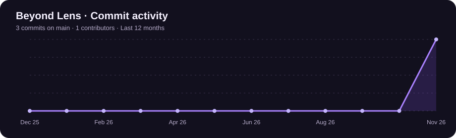

<div align="center">

# BEYOND LENS

<a href="https://github.com/kr-xyriin/beyond-lens">
  
</a>

An independent, AI-assisted platform connecting prospective college students with current students for firsthand perspectives and meaningful conversations.

<br />

[](./docs/)
[](./frontend/package.json)
[](https://github.com/kr-xyriin/beyond-lens/commits/main)

<br />

[](https://github.com/kr-xyriin/beyond-lens/stargazers)
[](https://github.com/kr-xyriin/beyond-lens/forks)
[](https://github.com/kr-xyriin/beyond-lens/graphs/contributors)
[](https://github.com/kr-xyriin/beyond-lens/issues)
[](https://github.com/kr-xyriin/beyond-lens/pulls)
[](https://github.com/kr-xyriin/beyond-lens/commits/main)

</div>

---

### ✦ The idea

College decisions deserve more than brochures and rankings. **Beyond Lens** is being built to help students ask better questions, hear authentic experiences, and make more informed choices.

### ⚡ Tech stack

**Frontend · in development**


**Planned backend**


### ◈ Development roadmap

| Phase | Focus | Status |
|:--:|---|:--:|
| **A** | Frontend foundation | 🟣 In progress |
| **B** | Authentication & profiles | ⚪ Planned |
| **C** | Date-based booking system | ⚪ Planned |
| **D** | AI-assisted guidance | ⚪ Planned |
| **E** | Payments & communication | ⚪ Planned |
| **F** | Testing & production launch | ⚪ Planned |

### 📊 Repository activity

<div align="center">



</div>

### 🚀 Run locally

```bash
git clone https://github.com/kr-xyriin/beyond-lens.git
cd beyond-lens/frontend
npm ci
npm run dev
```

To verify the production bundle:

```bash
npm run build
```

### 🗂 Repository layout

```text
beyond-lens/
├── frontend/      # React + TypeScript + Vite
├── docs/          # Architecture and project notes
├── archive/       # Earlier prototypes
└── README.md
```

The backend will be added as development progresses. Current screens include prototype/demo behavior; production authentication, bookings, payments, and AI services are not live yet.

---

<div align="center">

**Built around conversations that matter.**

<sub>Beyond Lens · Under active development</sub>

</div>
