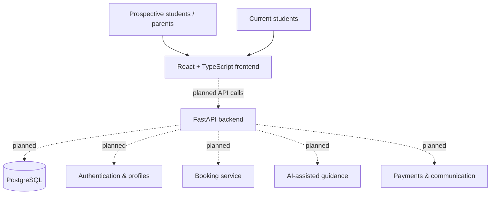

# 🏗 SYSTEM ARCHITECTURE

**A clear separation between what exists and what is proposed.**

[← Docs home](./README.md) · [Development](./development.md) · [Decisions](./decisions.md)

---

## ✦ Architecture at a glance

**Documented current foundation:** React + TypeScript + Vite frontend. The root README identifies Python, FastAPI, and PostgreSQL as a **planned** backend stack, not an implemented backend.

> **Diagram key:** Solid = current frontend interaction concept. Dashed = planned integration; not evidence of deployed services.

## ⚡ Component map

| Component | Technology / approach | Status | Responsibility |
|:--|:--|:--|:--|
| Web frontend | React, TypeScript, Vite, CSS | 🟣 In development | User interface and prototype flows |
| API layer | Python + FastAPI | ⚪ Planned | Business logic, validation, service orchestration |
| Database | PostgreSQL | ⚪ Planned | Persistent user, booking, and transaction records |
| Identity | To be designed | ⚪ Planned | Accounts, roles, authorization |
| Scheduling | To be designed | ⚪ Planned | Availability, date-based booking, conflict handling |
| AI assistance | To be designed | ⚪ Planned | Guidance with safeguards and source transparency |
| Payments & communication | Provider not selected | ⚪ Planned | Payments, notifications, user contact |

## ◈ Proposed request lifecycle

1. A visitor opens the frontend and browses available experiences.
2. **Once implemented**, the frontend authenticates the user and sends validated requests to the API.
3. The API applies authorization and business rules before accessing persistent data.
4. Booking operations check availability and avoid double-booking through transactional constraints.
5. AI-generated guidance, where appropriate, is clearly distinguished from firsthand student testimony.
6. Payments and communication are integrated only after provider selection, security review, and end-to-end testing.

## 🔒 Non-functional requirements (targets, not current guarantees)

| Area | Design target |
|:--|:--|
| Security | Server-side validation, least-privilege access, secure secrets management |
| Privacy | Collect only necessary personal data; define retention and deletion processes |
| Reliability | Explicit errors, retries where safe, and idempotent booking/payment operations |
| Performance | Efficient API calls, lazy loading, caching only where appropriate |
| Accessibility | Keyboard navigation, readable contrast, reduced-motion support |
| Trust | Avoid unverified institutional claims; distinguish opinion, experience, and verified information |
| Observability | Structured logs and error monitoring without exposing sensitive data |

## 🔗 Source of truth

The actual implementation is authoritative. Before describing any component as **implemented**, verify its code, tests, and running behavior in the [repository](https://github.com/kr-xyriin/beyond-lens). For evolving trade-offs, see [decision records](./decisions.md).

**Live code views:** [Frontend directory](https://github.com/kr-xyriin/beyond-lens/tree/main/frontend) · [Recent changes](https://github.com/kr-xyriin/beyond-lens/commits/main) · [Architecture-related issues](https://github.com/kr-xyriin/beyond-lens/issues?q=is%3Aissue+architecture)

---

[Docs home](./README.md) · [Roadmap](./roadmap.md) · [Main README](../README.md)

